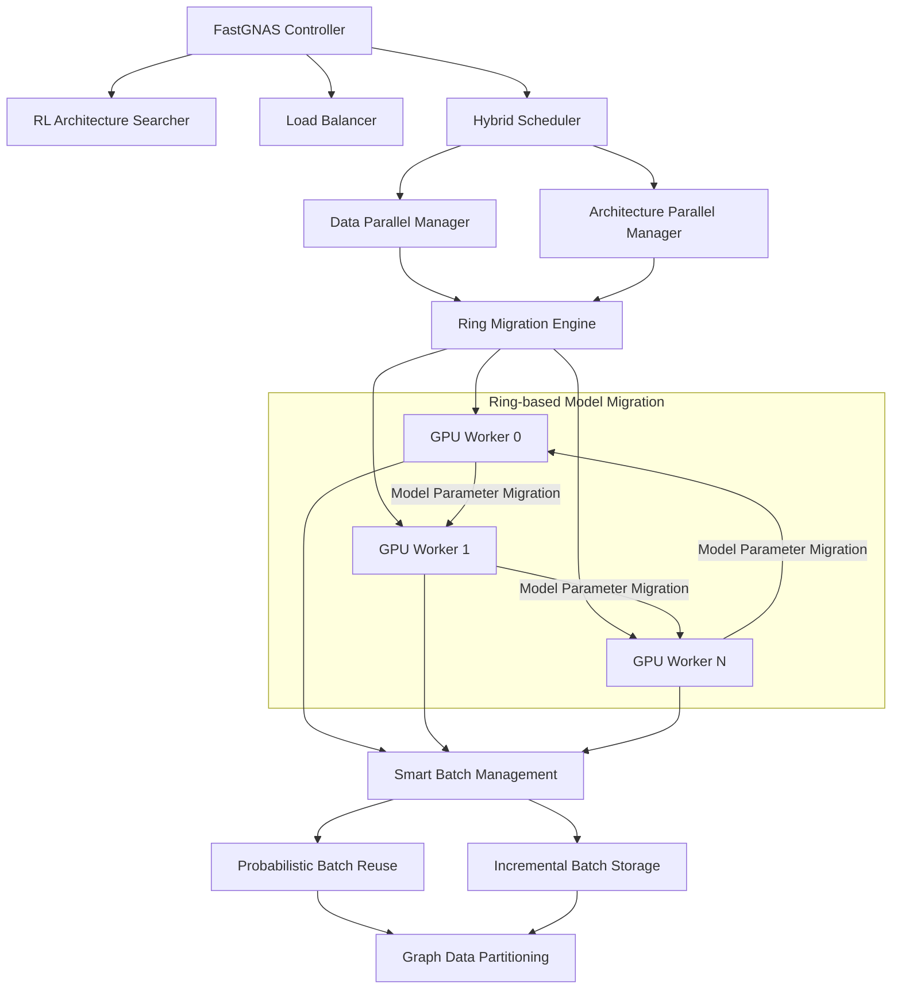
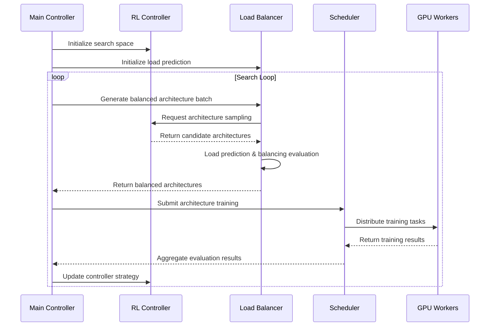

# 🚀 FastGNAS: Accelerating and Scaling Graph Neural Architecture Search with Ring-Based Model Migration

[](https://opensource.org/licenses/Apache-2.0)
[](https://www.python.org/downloads/)
[](https://pytorch.org/)
[](https://ray.io/)

**FastGNAS** is a fast, scalable multi-GPU framework designed for Graph Neural Architecture Search (GNAS). Through the innovative **Ring-Based Model Migration** mechanism, FastGNAS implements a hybrid training paradigm combining data parallelism and architecture parallelism, achieving **average 3.14x (up to 6.18x) acceleration** compared to existing baseline methods while maintaining competitive accuracy.

> **Core Paper Contribution**: FastGNAS exploits hybrid training with ring-based model migration, advanced batch management strategies, and fine-grained load balancing to achieve synchronization-free training and efficient resource allocation.

## ✨ Core Innovation Features

### 🔥 Revolutionary Acceleration Performance
- **⚡ 3.14x Average Speedup**: Compared to existing state-of-the-art baseline methods
- **🚀 Up to 6.18x Speedup**: Excellent performance across multiple benchmarks
- **🎯 Competitive Accuracy**: Achieving significant acceleration while maintaining high accuracy

### 🔄 Hybrid Training Paradigm
- **💫 Ring-Based Model Migration**: Innovative ring-based model migration mechanism
- **⚖️ Data + Architecture Parallelism**: Combining advantages of both to achieve synchronization-free training
- **🔗 Zero Synchronization Overhead**: Eliminating synchronization bottlenecks in traditional parallel training

### 🧠 Intelligent Batch Management
- **📈 Incremental Batch Storage**: Minimizing redundant batch generation
- **🎲 Probabilistic Batch Reuse**: Intelligent reuse strategy to reduce search costs
- **💾 Advanced Caching Strategy**: Optimizing memory usage and computational efficiency

### ⚖️ Fine-grained Load Balancing
- **🔍 Exploratory Task Generation**: Intelligent task allocation strategies
- **📊 Predictive Load Estimation**: Machine learning-based resource prediction
- **🎯 Precise Resource Allocation**: Optimized resource allocation across candidate architectures

### 🛠️ Extended Features
- **🧪 Multiple Search Strategies**: Support for Reinforcement Learning (RL), Shapley value evaluation, etc.
- **📊 Rich Experiment Configurations**: FastGNAS, CA, CO, AD and other experiment modes
- **🔧 Modular Design**: Clear architectural layering, easy to extend and maintain

## 📁 Project Directory Structure

```
FastGNAS/RingGNN/
├── 📂 core/                           # Core control and scheduling modules
│   ├── controller.py                  # RL controller and architecture search space
│   ├── balance_controller.py          # Load balancing controller
│   ├── dispatcher_v2.py              # Unified scheduling coordinator (refactored version)
│   ├── load_estimator.py             # Load predictor
│   ├── 📂 orchestration/              # Training orchestration modules
│   ├── 📂 registry/                   # Model registration management
│   ├── 📂 scheduling/                 # Scheduling strategy implementation
│   │   ├── bucket_scheduler.py       # Bucket scheduler
│   │   ├── rotation_scheduler.py     # Rotation scheduler
│   │   ├── subtask_scheduler.py      # Dynamic batch scheduler
│   │   └── unified_scheduler.py      # Unified scheduler
│   └── 📂 state/                      # State management module
│
├── 📂 trainer/                        # Training executor module
│   ├── worker.py                     # GPU training worker unit (Ray Actor)
│   └── builder.py                    # Dynamic GNN model builder
│
├── 📂 batching/                       # Batch processing and cache management
│   ├── hierarchical_cache_manager.py # Hierarchical cache manager
│   ├── simple_batch_manager.py       # Lightweight batch manager
│   └── cache_pool.py                 # Cache pool implementation
│
├── 📂 data/                          # Data loading and preprocessing
│   ├── data_utils.py                 # Dataset loader
│   └── partition.py                  # Graph partitioning strategy implementation
│
├── 📂 core/                          # Core components
│   ├── balancing.py                  # Load balancing algorithm
│   └── state_manager.py              # Model state management
│
├── 📂 experiment/                     # Experiment configuration directory
│   ├── 📂 FastGNAS-rl/               # Complete FastGNAS solution experiments
│   ├── 📂 FastGNAS-shapley/          # Shapley value evaluation experiments
│   ├── 📂 Ca-rl/                     # Centralized architecture search experiments
│   ├── 📂 Co-rl/                     # Collaborative architecture search experiments
│   └── 📂 Ad-rl/                     # Adaptive architecture search experiments
│
├── 📂 baseline/                      # Baseline algorithm implementation
│   ├── 📂 components/                # Baseline components
│   │   ├── 📂 backends/              # Backend implementation
│   │   └── 📂 searchers/             # Search algorithms
│   └── 📂 reference/                 # Reference implementations (DGNAP, etc.)
│
├── 📂 utils/                         # Common utility modules
│   ├── logger.py                     # Logging utility
│   ├── precision_explorer.py         # Hyperparameter precision exploration
│   ├── plot_search_timeline.py       # Search process visualization
│   └── utils.py                      # Common utility functions
│
├── 📂 tools/                         # Analysis and debugging tools
│   ├── memory_monitor.py             # Memory monitoring tool
│   ├── gpu_log_summary.py            # GPU log analysis
│   └── plot_memory.py                # Memory usage visualization
│
├── 📂 test_utils/                    # Testing tools
├── 📂 archive/                       # Historical code archive
├── 📂 dataset/                       # Dataset storage directory
├── 📂 logs/                          # Log output directory
│
├── 📄 configs/train.yaml            # Main training configuration file
├── 📄 requirements.txt               # Python dependency package list
├── 📄 environment.yml                # Conda environment configuration
├── 📄 run.py                        # Main entry script
├── 📄 train_mload.py                # Load prediction model training script
└── 📄 README.md                     # Project documentation
```

## 🏗️ FastGNAS System Architecture

### 🔄 Ring-Based Model Migration Architecture



### 🔧 Core Innovation Components

| Component | Paper Innovation | Key Features |
|------|------------|----------|
| **Ring Migration Engine** | 💫 Ring-based Model Migration | Synchronization-free training, parameter pipeline transmission |
| **Hybrid Scheduler** | 🔄 Data + Architecture Parallel Hybrid | Scalability + Isolation unified optimization |
| **Smart Batch Manager** | 📈 Probabilistic batch reuse/incremental storage | Minimize redundancy, reduce search cost |
| **Exploratory Load Balancer** | ⚖️ Predictive load estimation | Precise resource allocation, purposeful scheduling |
| **RL Architecture Searcher** | 🧠 Reinforcement learning strategy | LSTM network, entropy reward optimization |

## 🚀 Quick Start

### 📋 Environment Requirements

- **Python**: 3.11+
- **CUDA**: 12.1+
- **GPU**: CUDA-compatible NVIDIA GPU (multi-GPU environment recommended)
- **Memory**: 32GB+ RAM (more required for large-scale datasets)

### 🛠️ Environment Setup

#### Option 1: Conda Environment (Recommended)

```bash
# Clone the project
git clone <repository-url>
cd FastGNAS/RingGNN

# Create Conda environment
conda env create -f environment.yml
conda activate RTO

# Verify installation
python -c "import torch; import torch_geometric; import ray; print('Environment setup successful!')"
```

#### Option 2: Pip Installation

```bash
# Create Python virtual environment
python -m venv fastgnas_env
source fastgnas_env/bin/activate  # Linux/Mac
# fastgnas_env\Scripts\activate  # Windows

# Install dependencies
pip install -r requirements.txt
```

### 📦 Key Dependency Versions

| Package | Version | Description |
|---------|---------|-------------|
| PyTorch | 2.5.1+cu121 | Deep learning framework |
| PyTorch Geometric | 2.6.1 | Graph neural network library |
| Ray | 2.47.1 | Distributed computing framework |
| CUDA Toolkit | 12.1 | GPU computing platform |
| PyYAML | 6.0.2 | Configuration file parsing |
| Pydantic | 2.11.7 | Data validation |

## 🎯 Usage Guide

### 🏃‍♂️ Basic Usage

#### 1. Using Complete FastGNAS Solution

```bash
# Run with Cora dataset
python experiment/FastGNAS-rl/run.py --dataset Cora

# Run with ogbn-arxiv dataset (requires more GPU resources)
python experiment/FastGNAS-rl/run.py --dataset ogbn-arxiv

# Custom configuration file
python experiment/FastGNAS-rl/run.py \
    --dataset Cora \
    --config experiment/FastGNAS-rl/config.yaml
```

#### 2. Using Main Entry Script

```bash
# Basic run
python run.py --config configs/train.yaml

# Specify dataset
python run.py --config configs/train.yaml --dataset Cora

# Enable test mode
python run.py --config configs/train.yaml --test
```

#### 3. Training Load Prediction Model

```bash
# Train Mload load prediction model
python train_mload.py \
    --data dataset/Mload_dataset/fastgnas-a6000-batch.yaml \
    --lr 0.01 \
    --batch_size 512 \
    --max_epochs 400
```

### ⚙️ Configuration Guide

#### Main Configuration File (`configs/train.yaml`)

```yaml
training:
  dataset: "ogbn-products"          # Dataset selection
  lr: 0.01                          # Learning rate
  batch_size: 256                   # Batch size
  epochs_per_rotation: 5            # Training epochs per rotation
  fan_out: [15, 10]                 # Neighbor sampling count
  train_partition_strategy: "balanced_stratified_khop"  # Partition strategy

nas:
  num_search_rounds: 5              # Number of search rounds
  samples_per_round: 2              # Samples per round
  gnn_layers: 2                     # Number of GNN layers
  search_strategy: "layer_wise"     # Search strategy

  balancing_strategy:
    enable: true                    # Enable load balancing
    batch_size: 24                  # Batch architecture count
    tolerance: 0.1                  # Load balancing tolerance
    rotation_mode: "subtask"        # Scheduling mode
```

#### Supported Datasets

- **Small Datasets**: Cora, PubMed, Citeseer
- **Large Datasets**: ogbn-arxiv, ogbn-products, Flickr
- **Custom Datasets**: Supports any PyG format graph data

### 🧪 Experiment Types

| Experiment Type | Description | Use Case |
|------------------|-------------|-----------|
| **FastGNAS-rl** | Complete FastGNAS solution | Production environment, best performance |
| **Ca-rl** | Centralized architecture search | Single machine environment, simplified implementation |
| **Co-rl** | Collaborative architecture search | Multi-node collaboration scenarios |
| **Ad-rl** | Adaptive architecture search | Dynamic search strategy adjustment |
| **FastGNAS-shapley** | Shapley value evaluation | Feature importance analysis |

## 🔄 Detailed Workflow

### 📊 Architecture Search Flow



### 🎯 FastGNAS Distributed Training Mechanism

1. **💫 Ring-Based Model Migration**: Model parameters transfer in ring-based pipeline between GPUs, eliminating synchronization wait
2. **🔄 Hybrid Parallel Training**: Combines scalability of data parallelism and isolation of architecture parallelism
3. **⚡ Synchronization-Free Training**: No need to wait for all GPUs to complete, significantly reducing synchronization overhead
4. **📊 Result Aggregation**: Efficiently aggregate training results and architecture evaluations from all Workers

### ⚖️ Load Balancing Strategy

```python
# Bucket allocation algorithm example
def bucket_allocation(architectures, num_workers, tolerance=0.1):
    """
    Allocate architectures to different buckets based on load balancing
    """
    # 1. Sort by predicted load
    sorted_archs = sorted(architectures, key=lambda x: x['load'], reverse=True)

    # 2. Greedy allocation to least loaded bucket
    buckets = [[] for _ in range(num_workers)]
    bucket_loads = [0.0] * num_workers

    for arch in sorted_archs:
        min_bucket = argmin(bucket_loads)
        buckets[min_bucket].append(arch)
        bucket_loads[min_bucket] += arch['load']

    # 3. Evaluate balance
    avg_load = sum(bucket_loads) / num_workers
    max_diff = max(abs(load - avg_load) for load in bucket_loads)
    is_balanced = max_diff / avg_load <= tolerance

    return buckets, is_balanced
```

## 📈 Performance Optimization Features

### 💾 Hierarchical Caching Mechanism

- **Probabilistic Caching Decisions**: Optimize cache hit rate based on mathematical models
- **Hierarchical Matching**: Support cache reuse for architectures with different layer counts
- **Incremental Sampling**: Extend to higher layers based on existing cache
- **Fixed Loader Optimization**: Avoid overhead of repeatedly creating NeighborLoader

## 📊 Monitoring and Analysis

### 📋 Logging System

```bash
# View training logs
tail -f logs/logings/run_*/console.log

# Analyze GPU usage
python tools/gpu_log_summary.py logs/console_out/

# Monitor memory usage
python tools/memory_monitor.py --pid <process_id>
```

### 📈 Visualization Tools

```bash
# Generate search timeline
python utils/plot_search_timeline.py logs/logings/run_*/

# Analyze memory usage patterns
python tools/plot_memory.py logs/memory_*.log

# Extract training metrics
python tools/extract_train_metrics.py logs/logings/run_*/
```

## 🧪 Testing and Validation

### 🔍 Unit Testing

```bash
# Test cache manager
python -m pytest test_utils/test_cache_manager.py

# Test evaluation consistency
python -m pytest test_utils/test_evaluation_consistency.py

# Test Worker functionality
python -m pytest test_utils/test_worker_evaluation.py
```

### 🎯 Performance Benchmarking

```bash
# Run evaluation tests
python test_utils/run_evaluation_test.py

# Parallel backend tests
python test_utils/test_parallel_backends_v2.py
```

## 🔧 Advanced Configuration

### 🎛️ Hyperparameter Optimization

```yaml
nas:
  hyperparameter_optimization:
    strategy: "bayesian"           # Bayesian optimization
    n_initial_points: 42          # Initial random points
    n_calls: 100                  # Total evaluation count
    acquisition_func: "EI"        # Expected improvement function
    early_stop_patience: 3        # Early stopping rounds
```

### 📊 Load Prediction Configuration

```yaml
training:
  data_collection:
    enable_mload_collector: true   # Enable load collection
    device_type: "a6000"          # Device type
    time_window_mode: "batch"     # Time window mode
    flush_every: 1                # Flush frequency
```

## 🤝 Contributing Guide

### 📝 Development Environment Setup

```bash
# Install development dependencies
pip install -r requirements-dev.txt

# Install pre-commit hooks
pre-commit install

# Run code formatting
black .
isort .
```

### 🧪 Submitting Code

1. Fork the project repository
2. Create feature branch: `git checkout -b feature/amazing-feature`
3. Commit changes: `git commit -m 'Add amazing feature'`
4. Push branch: `git push origin feature/amazing-feature`
5. Create Pull Request

## 📄 License

This project is licensed under the Apache License 2.0. See the [LICENSE](LICENSE) file for details.


---

⭐ If this project helps you, please give us a star!

🚀 **FastGNAS** - Making graph neural architecture search more efficient and intelligent! Achieving revolutionary acceleration performance through Ring-Based Model Migration!